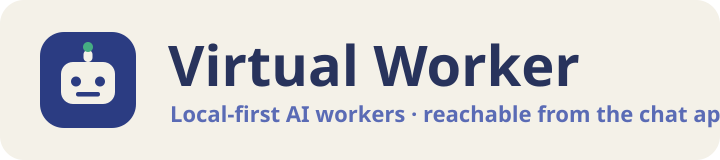

<p align="center">
  
</p>

# Virtual Worker

**Virtual Worker** is an open-source, local-first platform for running autonomous AI
workers on your own machine. A worker is more than a chatbot: it has a persona, tools,
skills, memory, a task board, schedules, and guardrails. It runs on a local model by
default (or a provider you bring your own key for), and the roadmap makes it reachable
from the chat apps people already use, starting with **WhatsApp**.

Everything is local by default: chats, agents, memory, downloaded models, and API traces
stay on your machine. Nothing leaves it unless you explicitly use web search, a remote
MCP server, a remote upstream, or a connected chat channel.

> Status: early. The core runtime (agents, harness, board, schedules, triggers, delivery,
> skills, knowledge, templates, gateway, traces) and the first chat channel (WhatsApp)
> work today. See [`docs/PRD.md`](docs/PRD.md) for the full product plan.

## What it does today

- **Chat channels**: message an agent from **WhatsApp**, **Telegram**, **Discord** or
  **Slack**. WhatsApp pairs a number by scanning a QR code (linked device, no public URL
  needed) or uses the official Cloud API webhook; Telegram, Discord and Slack take bot
  tokens and dial out. DM and group policies, an allow-list with pairing approval,
  per-chat agent routing, per-conversation history, media in and out, and an audited
  `channel_send` tool for proactive messages. One adapter interface for all of them.
- **Service mode**: `./vw start` runs everything detached with automatic restarts and the
  built UI on one port; `./vw install-service` makes it start at login or boot (launchd on
  macOS, systemd on Linux); `./vw run <agent> "<prompt>"` runs an agent headlessly from
  the terminal.
- **Agents** with a persona, model, working folder, memory, skills, MCP servers, custom
  tools, and guardrails. Chat with them in the web UI with streaming tool activity.
- **Agent harness**: tool registry, agent loop, context budgeting, automatic guardrails
  (working-folder confinement, shell deny-list, caps, kill switch), and a verify pass.
- **Document reading**: agents open PDF, Word, Excel, PowerPoint, CSV and text files from
  their working folder and from chat attachments, in chunks that fit the context.
- **Task board and activity feed** per agent, with an always-on worker that pulls tasks
  when the agent is on duty.
- **Schedules** (cron and one-time) and **triggers** (file watch, inbound webhook).
- **Outbound delivery** to in-app chat, desktop notifications, webhooks, email (SMTP, to an
  allow-list) and connected chat channels, with an audit log and a Deliveries page.
- **Skills** as portable `SKILL.md` packs with progressive disclosure.
- **Knowledge bases** with local embeddings and cited retrieval.
- **Templates**: deploy a ready-made agent from a gallery, export or import bundles.
- **Models**: discover and download models from Hugging Face, see what fits your
  machine, activate one. Managed llama.cpp (GGUF) and MLX (Apple Silicon) engines, or
  any OpenAI-compatible upstream (Ollama, vLLM, LM Studio).
- **External providers (bring your own key)**: any agent can run on OpenAI, Anthropic,
  DeepSeek, OpenRouter or a custom OpenAI-compatible gateway instead of the local model,
  with prompt caching, reasoning-effort control and per-call cost tracking. Keys are
  stored once, write-only.
- **Browser tools**: self-hosted web search (SearXNG), headless page reading, and an
  interactive browser the agent can drive (open, click, type, screenshot) with a
  persistent profile so logins stick. It can also attach to your own running Chrome,
  where the small [companion extension](browser-extension/README.md) groups the
  agent's tabs the way Claude in Chrome does.
- **Coding harness**: see your Claude Code and Codex sessions and send them prompts from
  any chat channel (`/code …`, `/codex …`) or in plain language through a worker; results
  flow back into the same chat.
- **Knowledge wikis**: an agent-maintained wiki of cross-linked markdown pages, plus
  linked repository wikis, searchable with cited answers.
- **Context compression**: large tool results are crushed to what matters, with the
  original kept locally and retrievable on demand, so local models stay fast.
- **Delegation with flow-back**: an agent can assign work to a teammate's board; when
  it finishes, the assigning agent is woken in the originating chat with the result.
- **Template registries**: host team templates in a git repository, deploy with
  provenance, and update deployed agents with a diff.
- **Desktop packaging**: an Electron shell with a frozen backend (see `desktop/`).
- **Multi-protocol gateway**: use your local model from coding agents over OpenAI,
  Anthropic Messages, OpenAI Responses and Gemini shaped endpoints, protected by minted
  API tokens.
- **Traces**: every model call captured locally with tokens, cost, latency and tool
  calls. Analytics and monitoring on top.
- **Optional team mode** with accounts, roles enforced on every mutating route, a login
  rate limit and an audit log, for a shared host. Off by default.
- **Backup and restore** of the whole data directory, plus opt-in scheduled local
  snapshots with retention.

## Run

```bash
./dev.sh                 # hot-reload dev profile
#   web   → http://localhost:5173
#   api   → http://127.0.0.1:8889   (OpenAPI docs: /docs)
#   model → http://127.0.0.1:8081/v1   (backend-managed)

./vw start               # always-on service: built UI + API on one port, auto-restart
#   app   → http://127.0.0.1:8888   (model server on :8080)
./vw status | ./vw logs -f | ./vw restart | ./vw stop
```

Dev and service use different default ports and data directories (`./data` for dev,
`~/.virtual-worker` for the service), so both can run side by side.

The first time the web UI opens, a guided setup walks you through picking a model
(download a recommended one, use one already on disk, or add a provider key), deploying
a starter worker from a template, and optionally connecting Telegram or Discord. Re-run
it any time from Settings.

Either launcher bootstraps on first run via `setup.sh` (backend venv with `uv`, frontend
deps, llama.cpp via Homebrew, and the MLX engines on Apple Silicon). Prerequisites it
cannot install for you: **uv**, **Node.js**, and **Homebrew** (for llama.cpp). Then open
**Models**, download a model, and **Activate** it.

Use your own model server instead of the managed one:

```bash
VW_UPSTREAM_URL=http://127.0.0.1:11434 ./dev.sh   # e.g. Ollama
```

Run a worker without the UI:

```bash
./vw run "Personal Assistant" "summarize README.md in three bullets"
```

A quick tour once the wizard is done: chat with the worker and ask it to write a
file in its working folder, then open **Debug** for the trace; rate a reply with
the thumbs and find it under **Analytics → feedback**; add a schedule with a
delivery target and watch **Deliveries**; turn on scheduled snapshots under
**Settings → Backup**.

## Configuration

All local state lives under `VW_HOME` (default `~/.virtual-worker`; `dev.sh` sets it to
`./data`). The database is `app.db`, app settings are `settings.json`.

| Env var | Default | Purpose |
|---|---|---|
| `VW_HOME` | `~/.virtual-worker` | data dir (db, settings, logs, pid) |
| `VW_PORT` | `8888` | service port for `./vw start` (dev uses `BACKEND_PORT`, default `8889`) |
| `VW_UPSTREAM_URL` | `http://127.0.0.1:8080` | OpenAI-compatible model server; setting it disables managed mode |
| `VW_MANAGED_LLAMA` | `1` | backend starts, stops and switches the model server |
| `VW_MODEL_MAP` / `VW_DEFAULT_MODEL` | – | map vendor model ids to your local model |
| `VW_GATEWAY_KEY` | – | require a static key on the gateway |
| `VW_DEBUG_CAPTURE` | `1` | capture model calls into the trace store |
| `VW_SKIP_MLX` | `0` | skip the MLX engines on Apple Silicon |
| `VW_DL_CONNECTIONS` / `VW_DL_CHUNK_MB` | `16` / `16` | parallel download tuning |
| `LLAMA_*` / `MLX_*` | – | engine binaries, port, context, GPU layers |
| `HF_TOKEN` | – | gated or private Hugging Face repos |
| `TAVILY_API_KEY` / `BRAVE_API_KEY` | – | optional web search providers |
| `VW_ALLOWED_HOSTS` | – | extra Host names accepted besides localhost (LAN IP, public webhook host) |
| `VW_CORS_ORIGINS` | – | extra browser origins allowed to call the API (local origins always are) |
| `VW_TRACE_RETENTION_DAYS` / `VW_TRACE_MAX_RUNS` | `30` / `20000` | trace retention |
| `VW_ACTIVITY_RETENTION_DAYS` / `VW_DELIVERY_RETENTION_DAYS` | `90` / `90` | activity and delivery audit retention |
| `VW_CHANNEL_MEDIA_RETENTION_DAYS` | `14` | received chat attachments are deleted after this |
| `VW_NODE_BIN` | `node` on PATH | Node binary for the WhatsApp bridge sidecar |
| `VW_WHATSAPP_MAX_MEDIA_BYTES` | `26214400` | cap on a received WhatsApp attachment |
| `VW_TELEGRAM_MAX_MEDIA_BYTES` | `20971520` | cap on a received Telegram attachment |

## Connect a chat app

**Telegram** (quickest): message `@BotFather`, send `/newbot`, copy the token. Open
**Channels → Connect a channel → Telegram**, paste the token, pick the default agent. Done.
No public URL is needed; the bot long-polls.

**Discord**: create an application in the Developer Portal, add a bot, enable the Message
Content intent, invite it to your server, and paste the bot token under **Channels**.

**Slack**: create an app, enable Socket Mode (app-level token), subscribe to `message.im`,
`message.channels`, install it, and paste both tokens under **Channels**.

**WhatsApp (linked device):**

1. Open **Channels → Connect a channel**, choose **WhatsApp (linked device)**, pick the
   default agent, and connect.
2. Click **Pair**, then on the phone: Settings → Linked devices → Link a device, and scan
   the QR code.
3. Message the number from another phone. Unknown senders receive a pairing code you
   approve on the card (the default DM policy); switch to **open** or **allowlist** as
   you prefer. In groups the agent answers only when mentioned.

The linked-device transport is a small Node sidecar built on the open-source
[Baileys](https://github.com/WhiskeySockets/Baileys) library, managed by the backend
like the model server. It is an unofficial client: use a dedicated number and accept
WhatsApp's terms. Businesses with a public URL can use the official **Cloud API**
transport instead.

## Let agents use a browser

Agents get `browser_open`, `browser_snapshot`, `browser_click`, `browser_type` and
friends: a real browser they drive step by step, with a persistent profile so your
logins stick. Two ways to run it:

**Launch mode (default).** Virtual Worker starts its own browser window. In the
agent's settings, under **Browser control**, click **Open browser to log in** once,
sign in to the sites your workers need, and close it; the sessions are kept. Nothing
else to set up.

**Attach mode: your own Chrome, with agent tabs grouped like Claude in Chrome.**

1. Start Chrome with remote debugging on a dedicated profile (Chrome 136 and later
   ignore the flag on the default profile):

   ```bash
   # macOS
   "/Applications/Google Chrome.app/Contents/MacOS/Google Chrome" \
     --remote-debugging-port=9222 --user-data-dir="$HOME/.virtual-worker/chrome-profile"
   # Linux
   google-chrome --remote-debugging-port=9222 --user-data-dir="$HOME/.virtual-worker/chrome-profile"
   ```

2. Install the companion extension in that Chrome: open `chrome://extensions`, turn on
   **Developer mode**, click **Load unpacked**, and pick the repository's
   [`browser-extension/`](browser-extension/README.md) folder. It only groups tabs; it
   has no popup, stores nothing, and talks to no server.
3. In Virtual Worker open **Settings → Browser**, choose **Attach**, enter
   `http://127.0.0.1:9222` as the CDP URL, and click **Relaunch agent browser**. Or set
   `VW_BROWSER_CDP_URL=http://127.0.0.1:9222` before starting the backend.
4. Ask a worker to open a page. Its tabs appear in a blue **Virtual Worker** tab group
   next to yours. Agents never take over one of your tabs on their own; tell one to work
   in a tab you have open and it switches there with `browser_tab_select`.

If nothing is listening on the CDP URL, Virtual Worker falls back to launching its own
browser and says so in the tool result, since the two browsers have separate logins.

## Drive Claude Code or Codex from your phone

If Claude Code or the Codex CLI is installed, a worker can watch and steer it:

1. **Settings → Coding harness**: confirm the binaries were found, pick Claude Code's
   permission mode for headless runs (Accept edits is a good default) and Codex's sandbox
   (Workspace write), and list the directories under which new sessions may start.
2. In the worker's settings, turn on **Guardrails → Integrations → Coding harness**.
3. From Telegram, WhatsApp, Discord or Slack:

   ```
   /code list                      your sessions, live ones first
   /code show virtual-worker-72    the last exchanges of a session
   /code run virtual-worker-72 run the tests and fix what fails
   /code jobs                      runs started from here
   /codex list                     the same commands for Codex
   ```

   Or just ask the worker: "what is Claude doing on the ticketing project?", "tell it to
   also update the changelog". The result of a run is posted back into the same chat when
   Claude Code finishes, with turns, tool calls and cost.

Claude Code sessions open in a terminal are forked rather than written to, new sessions
are confined to the allowed roots, and the channel's allow-list decides who may send
prompts at all.

## Security

The backend binds to localhost, allows only local browser origins, checks the Host
header, keeps secrets write-only, scrubs credential-shaped strings from logs, and
audits every outbound message. A maintenance loop keeps traces, activity, audit rows and
received media bounded. See [`SECURITY.md`](SECURITY.md) for the full model and how to
report a vulnerability.

## Tests

```bash
cd backend  && .venv/bin/python -m pytest -q
cd frontend && npm run build
```

## Roadmap

The product plan lives in [`docs/PRD.md`](docs/PRD.md). Next milestones:

1. Real-device validation of each channel and the first public release.
2. Desktop packaging and signed builds; Windows without WSL.
3. Local voice (speech to text and text to speech) in Chat.
4. Evaluation suites and fine-tuning from the feedback export.
5. A browser recorder that turns a recorded flow into a skill.

## Contributing

See [`CONTRIBUTING.md`](CONTRIBUTING.md). Licensed under [Apache-2.0](LICENSE).
